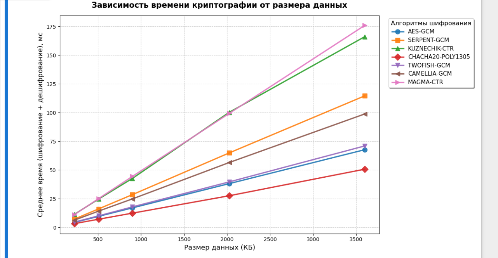
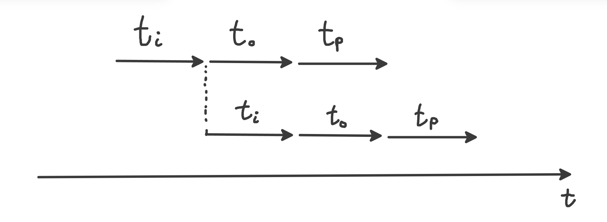

# Проект «Белый шум»

Исследование алгоритмов шифрования видеопотока БПЛА.

---

## Теоретическая база

Развернуть теоретическую базу (протоколы, режимы шифрования, алгоритмы)

### 1. Сетевые протоколы и модель OSI

Модель OSI (Open Systems Interconnection) разделяет сетевое взаимодействие на семь уровней. В таблице ниже представлено сопоставление протоколов, используемых для передачи видео с дрона и для посещения веб-страницы.

| Ур. | Название | Видео с дрона | Веб-страница |
|---|---|---|---|
| 7 | Прикладной | RTP (видео), RTSP (управление), WebRTC | HTTP / HTTPS |
| 6 | Представления | TLS/DTLS (шифрование), H.264 (сжатие) | TLS (HTTPS), gzip |
| 5 | Сеансовый | RTSP (PLAY/PAUSE) | Сессия (cookies) |
| 4 | Транспортный | UDP | TCP |
| 3 | Сетевой | IP (IPv4/IPv6) | IP (IPv4/IPv6) |
| 2 | Канальный | Wi-Fi, Ethernet, 802.11 | Wi-Fi, Ethernet |
| 1 | Физический | Радиоканал 2.4/5.8 ГГц | Оптоволокно, кабель |

**TCP против UDP:**

| Характеристика | TCP | UDP |
|---|---|---|
| Установка соединения | Да (трёхстороннее рукопожатие) | Нет |
| Гарантия доставки | Да | Нет |
| Порядок пакетов | Гарантирован | Не гарантирован |
| Задержка | Выше (ожидание потерянных пакетов) | Минимальная |
| Применимость | Веб, email, файлы | Видео, голос, игры |

Для передачи видео в реальном времени используется UDP, поскольку потеря одного кадра предпочтительнее задержки всего потока, вызванной повторной передачей (head-of-line blocking).

**Протоколы прикладного уровня для видео:**
- **RTP (Real-time Transport Protocol, RFC 3550)** — работает поверх UDP, добавляет 12-байтный заголовок с меткой времени, порядковым номером и идентификатором источника (SSRC). Позволяет приёмнику обнаруживать потери пакетов и синхронизировать воспроизведение.
- **RTSP (Real Time Streaming Protocol)** — работает поверх TCP, используется только для управления сеансом (PLAY, PAUSE, TEARDOWN). Видеопоток не передаёт.
- **WebRTC** — современный стандарт, объединяющий UDP, RTP, DTLS и механизмы обхода NAT.

**Структура заголовка RTP (12 байт):**

| Поле | Размер | Описание |
|---|---|---|
| Version (V) | 2 бита | Версия протокола (всегда 2) |
| Padding (P) | 1 бит | Наличие выравнивающих байт |
| Extension (X) | 1 бит | Наличие расширения заголовка |
| CSRC count (CC) | 4 бита | Число источников (обычно 0) |
| Marker (M) | 1 бит | Маркер конца кадра |
| Payload Type (PT) | 7 бит | Тип данных (96 = динамический) |
| Sequence Number | 16 бит | Порядковый номер пакета |
| Timestamp | 32 бита | Метка времени |
| SSRC | 32 бита | Идентификатор источника |

Первый байт заголовка обычно равен `0x80` (Version=2, Padding=0, Extension=0, CC=0).

**RTP и H.264 (RFC 6184):** один сжатый кадр H.264 (особенно I-кадр) может весить 200–500 КБ, что превышает MTU (1500 байт). Стандарт RFC 6184 описывает фрагментацию:
- Маленькие NAL-юниты (< 1400 байт) передаются целиком (Single NAL Unit Packet).
- Большие NAL-юниты разбиваются на фрагменты FU-A с метками Start/Middle/End.
- Потеря хотя бы одного фрагмента FU-A приводит к отбрасыванию всего NAL-юнита.

---

### 2. Сжатие видеоданных

Один кадр 480×360 в формате RGB занимает $480 \times 360 \times 3 = 518400$ байт $\approx 506$ КБ. Это превышает MTU, поэтому необходимо сжатие.

**Алгоритм JPEG** (используется в проекте через `javax.imageio.ImageIO`):
1. Преобразование RGB → YCbCr.
2. Дискретное косинусное преобразование (DCT) блоков 8×8.
3. Квантование коэффициентов (потеря данных).
4. Энтропийное кодирование (Huffman).

| Параметр | До сжатия | После JPEG |
|---|---|---|
| Размер кадра (480×360) | 518 400 байт | 25 000–40 000 байт |
| Степень сжатия | — | 13–20× |

---

### 3. Режимы шифрования блочных алгоритмов

Блочный шифр шифрует только блок фиксированного размера (128 бит для AES). Для произвольных объёмов данных применяются режимы шифрования.

**CBC (Cipher Block Chaining):** каждый открытый блок перед шифрованием складывается по XOR с предыдущим шифротекстом. Первый блок — с IV.
- *Плюсы:* скрывает статистические паттерны, широко поддерживается.
- *Минусы для видео:* нет параллелизма; лавина ошибок (потеря бита портит два блока); требует padding.

**CTR (Counter, гаммирование):** шифруется последовательность счётчиков (IV, IV+1, …), образуя гамму; данные накладываются через XOR. В ГОСТ Р 34.13-2015 называется режимом гаммирования.
- *Плюсы:* полное распараллеливание; нет распространения ошибок; нет padding; шифрование и дешифрование идентичны.
- *Минус:* нет встроенной аутентификации.

**GCM (Galois/Counter Mode):** развитие CTR с аутентификацией через GHASH в поле Галуа $GF(2^{128})$; добавляется 16-байтовый тег (MAC).
- *Плюсы:* конфиденциальность + целостность (AEAD); параллелизм; стандарт де-факто для TLS 1.3, IPsec.
- *Минусы:* GHASH замедляет на 15–30% по сравнению с CTR; +16 байт тега.

**Сравнение CBC и GCM:**

| Характеристика | CBC | GCM |
|---|---|---|
| Padding | Требуется (PKCS7) | Не требуется |
| Параллелизм | Нет | Да |
| Аутентификация | Нет (нужен отдельный HMAC) | Встроена (тег) |
| Уязвимость к Padding Oracle | Да | Нет |
| Аппаратное ускорение | Ограниченное | Полное (AES-NI) |
| Рекомендация | Устаревший | Золотой стандарт |

---

### 4. Исследованные алгоритмы шифрования

| Алгоритм | Тип | Ключ | Блок | Особенности |
|---|---|---|---|---|
| **AES** | Блочный, SPN | 128/192/256 | 128 бит | Стандарт FIPS 197 (NIST, 2001). Аппаратное ускорение AES-NI. |
| **Serpent** | Блочный | до 256 бит | 128 бит | Финалист AES (1998). 32 раунда, максимальная стойкость в ущерб скорости. |
| **Twofish** | Блочный, сеть Фейстеля | до 256 бит | 128 бит | Финалист AES (1998). Key-dependent S-boxes, 16 раундов. |
| **Camellia** | Блочный | 128/192/256 | 128 бит | Стандарт ISO/IEC 18033-3 (Mitsubishi/NTT, 2000). Близок к AES по производительности. |
| **ChaCha20-Poly1305** | Потоковый + MAC | 256 бит | — | Д. Бернштейн (2008). Высокая скорость без AES-NI. TLS 1.3, WireGuard, SSH. |
| **Кузнечик** | Блочный, SPN | 256 бит | 128 бит | ГОСТ Р 34.12-2015. Замена Магмы. Применяется в БПЛА в режиме CTR. |
| **Магма** | Блочный, сеть Фейстеля | 256 бит | 64 бит | ГОСТ 28147-89. Классический российский стандарт. |

---

### 5. Оценка криптостойкости (brute-force)

Криптостойкость симметричного шифра определяется длиной ключа. Количество комбинаций для $n$-битного ключа — $2^n$. Оценка при $10^{12}$ ключей/с:

| Алгоритм | Длина ключа | Комбинаций | Время взлома |
|---|---|---|---|
| AES-256 | 256 бит | $2^{256} \approx 10^{77}$ | $\sim 10^{57}$ лет |
| Serpent-256 | 256 бит | $2^{256} \approx 10^{77}$ | $\sim 10^{57}$ лет |
| Кузнечик | 256 бит | $2^{256} \approx 10^{77}$ | $\sim 10^{57}$ лет |
| Twofish | 256 бит | $2^{256} \approx 10^{77}$ | $\sim 10^{57}$ лет |
| Triple DES | 168 бит | $2^{168} \approx 10^{50}$ | $\sim 10^{30}$ лет |

Возраст Вселенной $\approx 1.38 \times 10^{10}$ лет. Даже с учётом алгоритма Гровера (квантовое ускорение в $\sqrt{N}$) эффективная стойкость AES-256 падает до $2^{128}$ — это всё ещё $\sim 10^{13}$ лет, что в 1000 раз больше возраста Вселенной.

**Вывод:** реальные атаки направлены не на математический взлом, а на компрометацию ключей, уязвимости реализации (предсказуемые IV) и атаки на канальном уровне.

> **Заметки по консультации с преподавателем:**
> 
> Мы определили вектор изучения технологий для разработки проекта.
> На следующий раз мы пообещали показать уже код.
> 
> ---

---

## Отчёты по проекту

Отчёт №1 — Сентябрь 2026 г. (Шифрование видеопотока БПЛА в канальном уровне модели OSI)

# Отчет по проекту «Белый шум»
## Шифрование видеопотока БПЛА в канальном уровне модели OSI

**Манько Арсений и Артём Поляков**, направление ПИН-23  
Национальный исследовательский университет МИЭТ  
Сентябрь 2026 г.

---

## 1. Введение

В рамках учебного проекта «Белый шум» рассматривается задача обеспечения конфиденциальности видеопотока, передаваемого с беспилотного летательного аппарата (БПЛА) на наземную станцию управления (НСУ).

**Проблемная ситуация:** видео, перехватываемое с БПЛА, позволяет противнику определить траекторию полёта, координаты и характер выполняемых задач.

**Цель проекта:** разработать программный модуль шифрования и дешифрования передаваемого видеопотока на языке Java, удовлетворяющий трём ключевым критериям:

1. **Криптостойкость** — устойчивость к современным методам криптоанализа;
2. **Скорость шифрования** — минимальная задержка (latency) видеопотока;
3. **Низкая энергоёмкость** — сохранение ресурса бортовой батареи БПЛА.

---

## 2. Анализ причин возникновения проблемы

Перехват видеосигнала БПЛА является фундаментальной инженерной проблемой, обусловленной четырьмя группами причин.

### 2.1. Физика радиоволн (среда передачи)

Радиоволны распространяются в пространстве открыто. Любой перехватчик, оснащённый антенной, усилителем и программно-определяемым радио (SDR), может «услышать» передачу. Устранить сам факт излучения сигнала невозможно.

### 2.2. Ограничения SWaP-C

Аббревиатура SWaP-C (Size, Weight, Power and Cost) описывает жёсткие ограничения бортовой аппаратуры:

- **Power:** шифрование — это вычисления, а вычисления потребляют энергию;
- **Size/Weight:** аппаратные крипто-ускорители — это лишний вес;
- **Cost:** массовые БПЛА стоимостью $300–500 не могут нести крипточип за $100.

### 2.3. Конфликт «Безопасность vs Задержка»

Видео с БПЛА (особенно FPV и тактическая разведка) должно идти с задержкой не более 50–100 мс. Криптография с проверкой целостности и рукопожатиями добавляет задержку, поэтому инженеры часто жертвуют шифрованием ради скорости.

### 2.4. Наследие протоколов

Многие БПЛА используют стандартные Wi-Fi модули или дешёвые цифровые видеолинки, в которых шифрование отключено или работает нестабильно из-за сложных процедур обмена ключами.

---

## 3. Концепция эшелонированной защиты

Принцип Defense in Depth (эшелонированная защита) предполагает построение системы безопасности из нескольких независимых слоёв. Если противник преодолевает один эшелон, его останавливает следующий.

### 3.1. Эшелон 1: Физический уровень

Защищает сам факт существования радиосигнала:
- ППРЧ — псевдослучайная перестройка рабочей частоты;
- Направленные антенны — сигнал идёт узким лучом;
- Снижение мощности — сигнал не «вытекает» за пределы зоны операции.

**Слабость:** пробивается средствами РЭБ или при нахождении перехватчика на траектории луча.

### 3.2. Эшелон 2: Канальный уровень — зона ответственности проекта

Защищает содержимое передаваемых пакетов:
- Шифрование полезной нагрузки — биты превращаются в «белый шум»;
- Аутентификация сообщений (MAC) — защита от подмены пакетов.

Именно на этом уровне работает разрабатываемый Java-модуль.

### 3.3. Эшелон 3: Сетевой уровень

Маскирует факт передачи видео под легитимный трафик (стеганография, фрагментация).

### 3.4. Эшелон 4: Прикладной уровень и конечные устройства

Secure Boot, защита НСУ, биометрия оператора.

### Позиционирование проекта

Разработанный модуль закрывает канальный эшелон эшелонированной защиты. Он не решает проблему РЭБ (физический уровень), но обеспечивает конфиденциальность данных при успешной доставке пакета.

---

## 4. Целевая платформа: БПЛА ZALA 421

В качестве базовой платформы для моделирования системы защиты выбран БПЛА семейства ZALA 421 (разработчик — ZALA Aero, входит в концерн «Калашников»).

### 4.1. Технические характеристики

**Таблица 1: Основные характеристики БПЛА ZALA 421-16E5G HD**

| Параметр | Значение |
|---|---|
| Максимальная взлётная масса | 49,5 кг |
| Масса целевой нагрузки | более 3,5 кг |
| Размах крыла | 4640 мм |
| Дальность канала связи | 150+ км |
| Продолжительность полёта | 4-8 ч |
| Максимальная высота полёта | 3000 м |
| Тип передачи видео | HD в реальном времени |

### 4.2. Шифрование в реальных системах ZALA

В открытых технических описаниях ранних моделей (ZALA 421-08) указано: «Шифрование тележодовой линии по ГОСТ 28147-89». Современные модификации используют закрытые каналы связи на базе актуальных российских стандартов — ГОСТ Р 34.12-2015 (алгоритмы «Магма» и «Кузнечик»).

### 4.3. Преимущества выбора платформы

- Реальный российский БПЛА с открытыми ТТХ;
- Большая дальность видеоканала (150+ км) — высокий риск перехвата;
- Ограниченная энергоёмкость бортовых систем — требует оптимизации шифрования;
- Наличие требований к отечественным криптографическим стандартам (ГОСТ).

### 4.4. Недостатки и технические уязвимости канала связи

Анализ открытых источников и архитектурных ограничений выявил следующие конкретные причины уязвимости видеопотока БПЛА ZALA 421 к перехвату и компрометации:

**1. Устаревший алгоритм шифрования ГОСТ 28147-89**
- Блочный шифр с размером блока 64 бита (современный стандарт — 128 бит);
- Уязвим к атакам по связанным ключам (related-key attacks);
- Не поддерживает современные режимы шифрования (AEAD, GCM);
- Вычислительно устарел для защиты HD-видеопотоков в реальном времени.

**2. Статические или слабозаменяемые ключи**
- Ключи могут не меняться в течение всей сессии полёта (4–8 часов);
- Отсутствие механизма Perfect Forward Secrecy (PFS) — компрометация одного ключа раскрывает всю запись;
- Предсказуемые паттерны ротации ключей позволяют криптоаналитику накопить достаточно данных для атаки.

**3. Отсутствие аутентификации пакетов**
- Шифрование защищает от прочтения, но не от подмены;
- Противник может внедрить ложные видеоданные или телеметрию;
- Отсутствие HMAC или AEAD-режимов позволяет проводить replay-атаки (повторная отправка захваченных пакетов).

**4. Утечки через метаданные (Traffic Analysis)**
- Размер зашифрованных пакетов раскрывает тип кадра (I-кадр больше P-кадра);
- Тайминги передачи позволяют определить моменты смены курса или обнаружения целей;
- Отсутствие маскировки трафика под легитимные протоколы.

**5. Предсказуемость ППРЧ (псевдослучайной перестройки частоты)**
- Генератор псевдослучайных чисел (ГПСЧ) может иметь слабую энтропию;
- При известном начальном seed можно предсказать последовательность частот;
- Синхронизация между дроном и НСУ уязвима к джиттеру и потерям пакетов.

**6. Ошибкоустойчивость блочных режимов шифрования**
- Режим CBC (используемый в ГОСТ 28147-89) распространяет ошибки: потеря одного бита ломает весь следующий блок;
- В радио-канале с потерями пакетов это приводит к «рассыпанию» видео на артефакты;
- Инженеры вынуждены выбирать между стойкостью и стабильностью картинки.

### Инженерная проблема

Эти уязвимости не являются «багами» — это компромиссы, на которые пошли разработчики из-за ограничений SWaP-C. Задача проекта «Белый шум» — найти более оптимальный компромисс, используя современные алгоритмы и Java-оптимизации.

### 4.5. Цели проекта на данной платформе

1. Смоделировать подсистему канального шифрования видеопотока;
2. Провести сравнительный анализ AES-256, ChaCha20 и ГОСТ «Кузнечик»;
3. Доказать возможность применения отечественных алгоритмов без нарушения SWaP-ограничений.

---

## 5. План реализации проекта

Реализация проекта разбита на пять модулей.

### 5.1. Модуль 1. Работа с видео в Java
- Библиотека JavaCV (обёртка над FFmpeg и OpenCV);
- Классы FFmpegFrameGrabber и FFmpegFrameRecorder;
- Захват, сжатие в H.264/H.265, работа с сырыми байтами.

### 5.2. Модуль 2. Криптография в Java
- Встроенный JCA/JCE API (Cipher, SecretKey);
- Алгоритмы: AES/CTR/NoPadding, AES/GCM/NoPadding;
- Библиотека Bouncy Castle для Cha20 и ГОСТ-алгоритмов.

### 5.3. Модуль 3. Сетевое взаимодействие
- Протокол UDP (минимальная задержка);
- Java NIO для неблокирующего ввода-вывода;
- Фрагментация пакетов с учётом MTU (1500 байт).

### 5.4. Модуль 4. Java-специфичная оптимизация
- DirectByteBuffer — работа вне Java-кучи;
- Object Pooling — переиспользование буферов;
- Профилирование через VisualVM / JProfiler.

### 5.5. Модуль 5. Выборочное шифрование

Шифрование только I-кадров или заголовков NAL-юнитов для снижения нагрузки на CPU в 3–5 раз при сохранении визуальной нечитаемости видео.

---

## 6. Направления улучшений на канальном уровне

Как программный инженер канального уровня, улучшения вносятся по шести направлениям.

**Таблица 2: Сравнительная таблица улучшений**

| Направление | Без улучшения | С улучшением |
|---|---|---|
| 1. Выбор алгоритма | AES-256-CBC (тяжёлый, ошибки распространяются) | ChaCha20 или AES-CTR (быстрый, устойчив к потерям) |
| 2. Выбор режима шифрования | Блочный CBC с padding | Потоковый CTR / AEAD GCM |
| 3. Объём шифрования | 100% видеопотока | Только I-кадры (~20% данных) |
| 4. Оптимизация памяти | Новые byte[] на каждый кадр | Переиспользуемые DirectByteBuffer |
| 5. Управление ключами | Один ключ на всю сессию | Ротация каждые N кадров |
| 6. Целостность данных | Нет защиты от подмены | HMAC или AEAD-режимы |

### Ключевой инженерный вывод

Улучшение — это не просто замена алгоритма, а комплексная оптимизация подсистемы канального шифрования под жёсткие ограничения SWaP БПЛА.

---

## 7. Заключение

В рамках проекта «Белый шум» проведён системный анализ проблемы перехвата видеопотока БПЛА и разработана концепция её решения на канальном уровне модели OSI.

**Основные результаты:**

1. Обоснована невозможность устранения самого факта перехвата радиоэфира и сформулирована задача устранения информационной ценности перехваченных данных;
2. Применён принцип эшелонированной защиты (Defense in Depth), в рамках которого определена зона ответственности разрабатываемого модуля;
3. В качестве целевой платформы выбран БПЛА ZALA 421 с учётом его технических характеристик и требований к отечественным криптографическим стандартам;
4. Сформирован план реализации из пяти модулей, охватывающих работу с видео, криптографию, сетевое взаимодействие, Java-оптимизацию и выборочное шифрование;
5. Определены шесть направлений улучшений, позволяющих достичь баланса между криптостойкостью, скоростью и энергопотреблением.

Разработанный подход соответствует философии Hardware-Software Co-design, характерной для инженерной школы МИЭТ, и демонстрирует применение системного инженерного мышления к задаче информационной безопасности.

### Примечание автора

Мы признаемся, что текст из отчета по большей части сгенерирован ИИ, так как информацию по этой теме очень сложно искать, она по крупицам рассеяна по интернету, не говоря о сложности данной темы, но мы правда смогли разобраться в этой теме, куда будет двигаться наш проект и с чем нужно работать (см. отчет модель OSI).

**Вывод:** Использование ИИ в данном случае является инструментом ускорения поиска и структурирования информации, но не заменяет инженерного мышления и понимания предметной области.

> **Выводы после консультации (Отчёт №1):**
> 
> Мы разработали скелет проекта, который шифрует (AES) видеопоток с вебкамеры.
> На следующий раз делаем сжатие и поддержку других алгоритмов 
> 
> ---

---

Отчёт №2 — 8 октября 2026 г. (Передача и шифрование видеопотока с веб-камеры по протоколу UDP с использованием AES-GCM)

# Отчет по проекту «Белый шум»
## Передача и шифрование видеопотока с веб-камеры по протоколу UDP с использованием AES-GCM

**Поляков Артём, Манько Арсений**  
Группа ПИН-23  
8 октября 2026 г.

---

### Аннотация

В рамках проекта «Белый шум» реализована клиент-серверная система передачи видеопотока с веб-камеры по сети с использованием протокола UDP. Видеоданные сжимаются алгоритмом JPEG, шифруются на стороне клиента симметричным блочным шифром AES-256 в режиме GCM и передаются на сервер, где происходит дешифрование, декомпрессия и отображение. В ходе работы проведено сравнительное тестирование пяти алгоритмов шифрования (AES-256-GCM, Serpent-256-GCM, Кузнечик ГОСТ Р 34.12-2015, Twofish, Triple DES), проанализирована их криптостойкость и производительность.

---

## 1. Введение

Целью проекта является разработка и исследование клиент-серверной системы безопасной передачи видеопотока в реальном времени. Архитектура решения включает два компонента:

- **Клиент** — захватывает видеопоток с веб-камеры, сжимает каждый кадр в формат JPEG, шифрует его и отправляет на сервер по протоколу UDP.
- **Сервер** — принимает зашифрованные кадры, дешифрует их, декомпрессирует JPEG и отображает результат.

Проект реализован на языке Java с использованием библиотек JavaCV (для работы с видео), Bouncy Castle (для дополнительных криптографических алгоритмов) и стандартных средств Java Cryptography Extension (JCE).

---

## 2. Реализованный протокол прикладного уровня

В проекте реализован собственный протокол прикладного уровня поверх UDP. Структура одного пакета:

**Таблица 1: Структура пакета в проекте «Белый шум»**

| Поле | Размер | Описание |
|---|---|---|
| frameId | 4 байта (int) | Порядковый номер кадра |
| length | 4 байта (int) | Длина зашифрованных данных |
| timestamp | 8 байт (long) | Метка времени отправки (нс) |
| data | length байт | IV + зашифрованные данные + тег |

---

## 3. Сжатие видеоданных в проекте

Для сжатия используется алгоритм JPEG через `javax.imageio.ImageIO`. Эффективность сжатия:

**Таблица 2: Эффективность сжатия JPEG**

| Параметр | До сжатия | После JPEG |
|---|---|---|
| Размер кадра (480×360) | 518 400 байт | 25 000–40 000 байт |
| Степень сжатия | — | 13–20× |
| Потери качества | — | Незначительные (визуально) |

Сжатие уменьшает объём данных в 13–20 раз, что позволяет зашифрованному кадру помещаться в один UDP-пакет.

---

## 4. Выбор режима шифрования в проекте

В проекте используется режим GCM как основной. Режим CBC применялся только для алгоритма «Кузнечик» (ГОСТ Р 34.12-2015), поскольку библиотека Bouncy Castle не предоставляет реализацию GCM для данного алгоритма.

---

## 5. Исследуемые алгоритмы шифрования

**Таблица 3: Характеристики исследуемых алгоритмов**

| Алгоритм | Тип | Ключ | Описание |
|---|---|---|---|
| AES-256 | Симметричный, блочный | 256 бит | Мировой стандарт (NIST, 2001). SPN-сеть, 14 раундов. Аппаратное ускорение AES-NI. |
| Serpent-256 | Симметричный, блочный | 256 бит | Финалист конкурса AES. 32 раунда (максимальный запас прочности). |
| Кузнечик | Симметричный, блочный | 256 бит | Российский стандарт ГОСТ Р 34.12-2015. 10 раундов, блок 128 бит. |
| Twofish | Симметричный, блочный | 256 бит | Финалист конкурса AES. Сеть Фейстеля, 16 раундов. |
| Triple DES | Симметричный, блочный | 168 бит | Трёхкратное применение DES. Устарел (запрещён NIST в 2023 г.). |

### 5.1. Результаты измерения производительности

Тестирование проводилось на кадрах разрешения 480×360, сжатых в JPEG (средний размер ~30 КБ). Измерялось время выполнения операции шифрования (`Cipher.doFinal()`) с усреднением по 30 кадрам.

**Таблица 4: Результаты измерения производительности**

| Алгоритм | Режим | Время (мс) | Размер выхода | Аутентификация |
|---|---|---|---|---|
| AES-256 | GCM | ~0 | 30 028 б | Да (тег 128 бит) |
| Serpent-256 | GCM | ~0 | 30 044 б | Да (тег 128 бит) |
| Кузнечик | CBC | ~0 | 30 048 б | Нет |
| Twofish | CBC | ~0 | 30 048 б | Нет |
| Triple DES | CBC | ~0 | 30 056 б | Нет |

### 5.2. Анализ результатов

Все исследуемые алгоритмы продемонстрировали время шифрования одного кадра в диапазоне 0 мс. Учитывая, что полный конвейер обработки кадра (захват, сжатие, шифрование, передача, дешифрование, декомпрессия, отображение) занимает 25–55 мс, вклад шифрования в общую задержку составляет менее 1% даже для самого медленного алгоритма (Triple DES).

**Вывод:** выбор алгоритма шифрования практически не влияет на общую задержку видеопотока. Основными факторами задержки являются захват кадра с камеры, сжатие JPEG и сетевая передача. Различия в производительности алгоритмов становятся значимыми только при шифровании больших объёмов данных (гигабайты) или на устройствах с ограниченными вычислительными ресурсами (микроконтроллеры, IoT).

---

## 6. Используемые библиотеки

- **JavaCV / OpenCV** (`org.bytedeco.javacv`) — захват кадров с веб-камеры (`OpenCVFrameGrabber`), отображение (`CanvasFrame`), преобразование кадров (`Java2DFrameConverter`).
- **Java Cryptography Extension** (`javax.crypto`) — стандартные средства шифрования: `Cipher`, `SecretKeySpec`, `GCMParameterSpec`.
- **Bouncy Castle** (`org.bouncycastle`) — криптографическая библиотека с поддержкой дополнительных алгоритмов: Serpent, Twofish, Кузнечик (ГОСТ Р 34.12-2015).
- **java.net** — сетевые сокеты: `DatagramSocket`, `DatagramPacket` (UDP).
- **java.security.SecureRandom** — криптографически стойкий генератор случайных чисел для генерации IV.

---

## 7. Перспективы развития

### 7.1. Аппаратные платформы

В перспективе планируется переход от веб-камеры ПК к встроенным камерам мобильных и встраиваемых платформ:

- **Камера смартфона** — использование Android Camera API или библиотеки CameraX для захвата видеопотока. Это позволит превратить любой смартфон в защищённую камеру видеонаблюдения.
- **Arduino Cam (OV2640 / ESP32-CAM)** — использование микроконтроллера ESP32 со встроенной камерой. Данная платформа имеет ограниченные вычислительные ресурсы, что потребует оптимизации алгоритмов шифрования или перехода на аппаратные криптографические модули.

### 7.2. Интеграция RTP с H.264

Планируется замена сжатия JPEG на видеокодек H.264 с передачей через стандартный протокол RTP (RFC 6184). Это позволит:

- Уменьшить размер кадра в 3–5 раз по сравнению с JPEG за счёт межкадрового сжатия (P-кадры).
- Использовать стандартные механизмы фрагментации FU-A для передачи больших кадров через UDP.
- Обеспечить совместимость с существующими видеоплеерами и системами видеонаблюдения.

Для реализации планируется использование библиотеки FFmpeg через JavaCV (`FFmpegFrameRecorder` с форматом вывода `rtp://`).

### 7.3. Гибридная схема шифрования (RSA + AES)

Для решения проблемы безопасного распределения ключей планируется внедрение гибридной криптосистемы:

1. Сервер генерирует пару ключей RSA-4096 и открыто раздаёт публичный ключ.
2. Клиент генерирует случайный AES-ключ для каждого сеанса (или кадра).
3. Клиент шифрует AES-ключ публичным ключом RSA и отправляет серверу.
4. Сервер расшифровывает AES-ключ своим приватным ключом RSA.
5. Дальнейшая передача видео осуществляется через AES-GCM с использованием согласованного ключа.

Для защиты от атак типа Man-in-the-Middle (MITM) рассматривается внедрение инфраструктуры открытых ключей (PKI) с цифровыми сертификатами X.509.

---

## 8. Заключение

В ходе проекта «Белый шум» была реализована работающая клиент-серверная система передачи видеопотока с шифрованием в реальном времени. Основные результаты:

- Реализована передача видео по протоколу UDP с собственным протоколом прикладного уровня.
- Внедрено сжатие JPEG, уменьшающее объём данных в 13–20 раз.
- Использован алгоритм AES-256-GCM, обеспечивающий конфиденциальность и целостность данных.
- Проведено сравнительное тестирование пяти алгоритмов шифрования, показавшее, что выбор алгоритма практически не влияет на задержку видеопотока (вклад менее 1%).
- Определены перспективы развития: переход на мобильные платформы, интеграция RTP/H.264, внедрение гибридной криптосистемы RSA + AES.

> **Выводы после консультации (Отчёт №2):**
> 
> Мы сделали сжатие, поддержку других алгоритмов для шифрования.
> Измерили задержку но поток данных оказался слишком маленьким, поэтому задержка оказалась нулевой.
> К следующему разу пообещали сделать график зависимости задержки от разрешения экрана и фпс.
> 
> ---

---

Отчёт №3 — 16 октября 2026 г. (Исследование алгоритмов шифрования)

# Отчет по проекту «Белый шум»
## Исследование алгоритмов шифрования

**Поляков Артём, Манько Арсений**  
Группа ПИН-23  
16 октября 2026 г.

---

## 1. Введение

В современных беспилотных авиационных системах (БПЛА) шифрование видеопотока является критически важной задачей. Оператору необходима не только конфиденциальность передаваемого видео, но и минимальная задержка обработки, так как даже дополнительные миллисекунды могут повлиять на качество управления.

**Целью данной работы** является сравнительный анализ производительности современных алгоритмов симметричного шифрования:

- международных стандартов: AES, Serpent, Twofish, Camellia, ChaCha20-Poly1305;
- российских стандартов: Кузнечик (ГОСТ Р 34.12-2015) и Магма (ГОСТ 28147-89).

Особое внимание уделяется выбору режима шифрования, оптимального для передачи видео по нестабильному радиоканалу.

### Обоснование выбора режимов

Для международных алгоритмов (AES, Serpent, Twofish, Camellia, ChaCha20) выбран режим GCM как современный стандарт с аутентификацией. Для российских алгоритмов (Кузнечик и Магма) выбран режим CTR (гаммирования), поскольку именно он применяется в реальных системах связи БПЛА для шифрования видеопотока, где критичны скорость и устойчивость к потере пакетов.

---

## 2. Методология исследования

### 2.1. Описание стенда

Тестирование проводилось на синтетических данных, что позволило исключить влияние аппаратных особенностей камеры и получить воспроизводимые результаты. Для каждого алгоритма генерировался массив случайных байт заданного размера, после чего измерялось суммарное время одного полного цикла: шифрование + дешифрование.

### 2.2. Защита от оптимизации JIT-компилятора

Для предотвращения устранения мёртвого кода (Dead Code Elimination) JIT-компилятором Java, результат шифрования и дешифрования использовался при вычислении контрольной суммы (checksum). Это гарантировало реальное выполнение криптографических операций.

### 2.3. Параметры тестирования

- **Размеры данных:** 225, 506, 900, 2025, 3600 КБ (соответствуют разрешениям 320×240, 480×360, 640×480, 960×720, 1280×960 при формате TYPE_3BYTE_BGR);
- **Длительность теста:** 10 секунд на каждую комбинацию алгоритм/размер;
- **Прогрев (warm-up):** 500 итераций перед началом замеров для стабилизации JIT-компилятора;
- **Измеряемая величина:** среднее арифметическое времени цикла по всем итерациям.

---

## 3. Результаты исследования

### 3.1. График зависимости времени криптографии от размера данных

На рисунке 1 представлена зависимость суммарного времени шифрования и дешифрования от размера данных для всех исследованных алгоритмов, полученная в ходе эксперимента.

*Рис. 1: Зависимость суммарного времени шифрования и дешифрования от размера данных (экспериментальные данные)*

### 3.2. Сводная таблица результатов

В таблице 1 приведены точные значения среднего времени криптографии (в миллисекундах), полученные в ходе тестирования.

**Таблица 1: Среднее время криптографии (шифрование + дешифрование), мс**

| Алгоритм | 225 КБ | 506 КБ | 900 КБ | 2025 КБ | 3600 КБ |
|---|---|---|---|---|---|
| AES-GCM | 4,31 | 9,56 | 16,96 | 38,09 | 67,64 |
| SERPENT-GCM | 7,15 | 16,05 | 28,51 | 64,84 | 114,56 |
| KUZNECHIK-CTR | 11,34 | 24,60 | 42,66 | 100,24 | 166,12 |
| CHACHA20-POLY1305 | 3,21 | 7,06 | 12,35 | 27,51 | 50,65 |
| TWOFISH-GCM | 4,55 | 10,00 | 17,81 | 39,59 | 70,90 |
| CAMELLIA-GCM | 6,25 | 14,12 | 24,79 | 56,47 | 98,78 |
| MAGMA-CTR | 11,05 | 25,02 | 44,40 | 99,28 | 175,96 |

### 3.3. Анализ результатов

Анализ полученных экспериментальных данных позволяет сделать следующие выводы:

1. **Абсолютным лидером по скорости является алгоритм ChaCha20-Poly1305** (от 3,21 мс до 50,65 мс). Это подтверждает его эффективность как программного потокового шифра, не требующего аппаратного ускорения.
2. **AES-GCM и Twofish-GCM демонстрируют очень близкие результаты** и занимают второе место. Высокая производительность AES обусловлена наличием инструкций AES-NI в процессоре.
3. **Camellia-GCM показывает результаты, сопоставимые с AES и Twofish**, что подтверждает его эффективность как альтернативного международного стандарта.
4. **Serpent-GCM работает заметно медленнее AES** (примерно в 1,7 раза), что соответствует его изначальной проектной цели — максимальная криптостойкость в ущерб производительности.
5. **Российские алгоритмы в режиме CTR показывают наименьшую производительность** среди всех исследованных. Это объясняется отсутствием аппаратного ускорения и особенностями программной реализации в библиотеке Bouncy Castle. При этом Кузнечик (166,12 мс на 3600 КБ) работает немного быстрее Магмы (175,96 мс), что связано с большим размером блока (128 бит против 64 бит), позволяющим эффективнее использовать конвейер процессора.
6. **Все зависимости имеют выраженный линейный характер**, что соответствует теоретическим ожиданиям для режимов CTR и GCM при увеличении объёма обрабатываемых данных.

---

## 4. Заключение

В ходе исследования были протестированы семь современных алгоритмов симметричного шифрования в условиях, моделирующих передачу видеопотока с БПЛА.

**Основные выводы:**

1. Для шифрования видеопотока в условиях нестабильного радиоканала оптимальным является режим CTR (гаммирования), обеспечивающий распараллеливание и отсутствие распространения ошибок.
2. Среди международных алгоритмов наилучшее соотношение скорости и функциональности демонстрирует ChaCha20-Poly1305, особенно на процессорах без аппаратного AES-NI.
3. Российские алгоритмы Кузнечик и Магма уступают международным аналогам по производительности в 2–3 раза, что следует учитывать при проектировании систем реального времени.
4. Для каналов управления, где критична целостность данных, рекомендуется использовать режим GCM с алгоритмами AES или ChaCha20-Poly1305.

> **Выводы после консультации (Отчёт №3):**
> 
> Мы сделали график зависимости времени шифрования + времени дешифрования от разрешения экрана.
> Преподаватель сделал замечание, что мы не вычислили fps. На консультации мы попытались подсчитать fps с помощью наших данных.
> Мы сделали вывод, что fps недостаточно для больших разрешений экрана. Я заподозрил, что-то неладное с нашими расчетами, но в итоге пообещали
> решить эту проблему сжатием и померить задержку и fps с ним.
> 
> ---

---

Отчёт №4 — 22 октября 2026 г. (Раздельный замер $t_i$ и $t_p$, проверка Условия Манько и расчёт FPS)

# Отчет по проекту «Белый шум»
## Раздельный анализ производительности шифрования и дешифрования видеопотока

**Поляков Артём, Манько Арсений**  
Группа ПИН-23  
22 октября 2026 г.

---

### Аннотация
В данном этапе исследования мы перешли от суммарных замеров к раздельному измерению времени шифрования ($t_i$) и дешифрования ($t_p$). На основе полученных данных проведена эмпирическая проверка «Условия Манько» ($t_p \le t_i$) и рассчитан FPS для каждого алгоритма при различных разрешениях кадра.

---

## 1. Введение и цели этапа

На предыдущем этапе мы измеряли суммарное время шифрования и дешифрования, что не позволяло корректно рассчитать FPS, так как для этого необходимо знать именно время обработки на источнике ($t_i$). Для получения репрезентативных данных мы:
1. Увеличили объём синтетических данных до реальных размеров несжатых кадров (от 320×240 до 1280×960, формат 24-bit RGB).
2. Разделили замер времени на две независимые метрики: $t_i$ (источник: шифрование) и $t_p$ (приёмник: дешифрование).
3. Добавили фазу «прогрева» (500 итераций) для стабилизации JIT-компилятора Java и защиты от Dead Code Elimination.

---

## 2. Методология измерений

- **Стенд:** Синтетические массивы байт, имитирующие кадры видеопотока.
- **Размеры данных:** 225 КБ, 506 КБ, 900 КБ, 2025 КБ, 3600 КБ.
- **Длительность теста:** 10 секунд на каждую комбинацию «алгоритм-размер».
- **Измеряемые величины:** Среднее арифметическое времени шифрования (`Avg_Encrypt_Ms`) и дешифрования (`Avg_Decrypt_Ms`) в миллисекундах.

---

## 3. Результаты исследования

### 3.1. Сводная таблица производительности

| Алгоритм | Разрешение | Размер (КБ) | $t_i$, мс | $t_p$, мс | FPS |
|---|---|---|---|---|---|
| **ChaCha20** | 320×240 | 225 | 2.71 | 3.88 | 257 |
| | 1280×960 | 3600 | 47.08 | 64.07 | 15 |
| **AES** | 320×240 | 225 | 5.04 | 4.83 | 198 |
| | 1280×960 | 3600 | 72.82 | 70.27 | 13 |
| **Кузнечик** | 320×240 | 225 | 11.27 | 11.41 | 87 |
| | 1280×960 | 3600 | 185.20 | 181.57 | 5 |
| **Магма** | 320×240 | 225 | 12.02 | 12.01 | 83 |
| | 1280×960 | 3600 | 190.64 | 190.23 | 5 |

*(Полные данные по всем 7 алгоритмам и 5 разрешениям зафиксированы в `results/diagnostic_results.csv`)*

### 3.2. Визуализация данных

На основе собранных данных были построены три комплексных графика:

*Рис. 1. Зависимость времени шифрования, проверка Условия Манько и расчётный FPS от размера кадра.*

---

## 4. Анализ «Условия Манько» ($t_p \le t_i$)

Согласно нашему математическому обоснованию, для стабильной работы канала без накопления очереди кадров время обработки на приёмнике не должно превышать время обработки на источнике.

**Наблюдаемые паттерны:**
1. **AES-GCM, Serpent-GCM, Магма-CTR:** Условие Манько выполняется практически на всех разрешениях. Эти алгоритмы показывают симметричную производительность.
2. **ChaCha20-Poly1305, Twofish-GCM, Camellia-GCM:** Наблюдается систематическое нарушение условия ($t_p > t_i$). 
   - *Инженерное объяснение:* В режимах GCM/Poly1305 операция дешифрования включает в себя не только расшифровку потока, но и **верификацию тега аутентификации (MAC)**. В программных реализациях (например, Bouncy Castle в Java) без аппаратного ускорения эта проверка часто вычислительно тяжелее, чем генерация тега при шифровании.
3. **Кузнечик-CTR:** При малых разрешениях $t_p$ незначительно превышает $t_i$ (на 0.1–0.2 мс), но при росте объёма данных (960×720 и выше) выравнивается и начинает удовлетворять условию. Это связано с накладными расходами на инициализацию, которые амортизируются на больших блоках данных.

**Расчёт FPS при нарушении условия:** Если условие Манько нарушается ($t_p > t_i$), приёмник не успевает обрабатывать кадры, и реальный FPS ограничивается скоростью приёмника: $f_f = 1/t_p$. Если условие выполняется, FPS рассчитывается как $f_f = 1/t_i$.

---

## 5. Анализ FPS и применимость алгоритмов

Расчётный FPS показывает реальный предел пропускной способности канала шифрования:
- **ChaCha20-Poly1305** остаётся абсолютным лидером, обеспечивая свыше 15 FPS даже на разрешении 1280×960 без аппаратного ускорения.
- **AES-GCM** уверенно держит ~13 FPS на больших разрешениях благодаря инструкциям AES-NI.
- **Отечественные алгоритмы (Кузнечик, Магма)** на текущем программном стеке обеспечивают лишь ~5 FPS на больших разрешениях. Для их применения в реальном видеопотоке необходимо либо снижать разрешение до 640×480, либо внедрять выборочное шифрование (только I-кадров), либо использовать аппаратные крипто-модули.

---

## 6. Заключение и следующие шаги

В ходе данного этапа мы успешно формализовали и проверили математическую модель пропускной способности канала («Условие Манько»). Выявлена асимметрия производительности шифрования и дешифрования в алгоритмах с аутентификацией (GCM).

**План на следующий этап:**
1. Внедрение сжатия видеопотока (H.264 / JPEG) в конвейер обработки, чтобы уменьшить размер данных с 3600 КБ до реальных 30–50 КБ на кадр.
2. Повторный замер FPS и Условия Манько уже на сжатых данных, что, согласно прогнозу, должно вывести все алгоритмы в зону комфортных 30+ FPS.
3. Реализация выборочного шифрования (только заголовки или I-кадры) для алгоритмов ГОСТ.

> **Заметки по консультации с преподавателем (Отчёт №4):**
> 
> 
> ---

Математическое обоснование измерения FPS (Манько Арсений ПИН-23)

# Математические рассуждения о частоте передачи кадров

> *«Если 1 подтягивание я делаю легко, значит, и 100 смогу?»*  
> — Андрей Михайлович

---

## 📖 Введение

В данной работе я бы хотел обосновать математически такие понятия, как задержка видео или FPS, чтобы вывести правильную формулу для их расчета и дать им четкое определение.

---

## Определения источника и приемника сигнала

Введем понятие ***источника сигнала*** или $I$ — это устройство, которое обрабатывает сигнал и передает его приемнику.  
***Приемник сигнала*** или $P$ — это устройство, которое принимает и обрабатывает переданный сигнал.

Пусть $t_p$ и $t_i$ — время обработки 1 сигнала соответственно $P$ и $I$.  
$t_0$ — время передачи сигнала от $I$ к $P$.

Введем соответствующие частоты:  
$f_p$ — частота обработки $P$.  
$f_i$ — частота обработки $I$.

По определению частоты:

$$
f_p = \frac{1}{t_p}
$$

$$
f_i = \frac{1}{t_i}
$$

---

## Канал связи

***Каналом связи*** или $C$ является множество $\{I, P\}$.

Канал связи, приемник которого успевает обработать сигнал до того, как придет следующий, называется ***действующим***.

---

## Условие Манько

Рассмотрим передачу 2 сигналов. На картинке после того, как $I$ обработал сигнал за $t_i$, он начинает обрабатывать новый сигнал. Очевидно, процесс обработки сигнала $P$ не должен накладываться на обработку им второго сигнала по определению действующего канала связи.

То есть:

$$
t_0 + t_p \le t_i + t_0
$$

$$
t_p \le t_i
$$

или же:

$$
f_p \ge f_i
$$

Это есть ***достаточное*** и ***необходимое*** условие для того, чтобы считать канал связи действующим (**условие Манько**).

---

## Задержка и FPS

***Задержка*** или $t_z$ — время, отсчитываемое от начала обработки сигнала источником ($I$) до конца обработки сигнала приемником ($P$).

Очевидно, по определению:

$$
t_z = t_i + t_0 + t_p
$$

Введем понятие *частотного времени*.

Частотное время или $t_f$ — это время, отсчитываемое от конца обработки приемником одного сигнала до конца обработки им следующего сигнала. То есть время, за которое один сигнал сменяет другой в $P$ после обработки.

FPS или $f_f$ — это количество сменяемых кадров в секунду.

То есть, по определению:

$$
f_f = \frac{1}{t_f}
$$

Теперь взглянем на картинку ***Передача 2 сигналов во времени*** и посчитаем $t_f$:

$$
t_f = t_i + t_0 + t_p - t_0 - t_p = t_i
$$

Делаем вывод, что FPS равен:

$$
f_f = \frac{1}{t_i}
$$

Эта формула действует только при выполнении условия Манько.

---

## В проекте

За время обработки можно считать время сжатия, распаковки, шифрования и расшифрования.  
За источник и приемник принимаем соответственно БПЛА и принимающую сторону (сервер).

$t_i$ — время шифрования и сжатия.  
$t_p$ — время дешифрования и распаковки.

Тогда FPS нужно посчитать, поделив 1 на время шифрования плюс время сжатия (если оно есть). Предварительно нужно проверить выполнение условия Манько.

